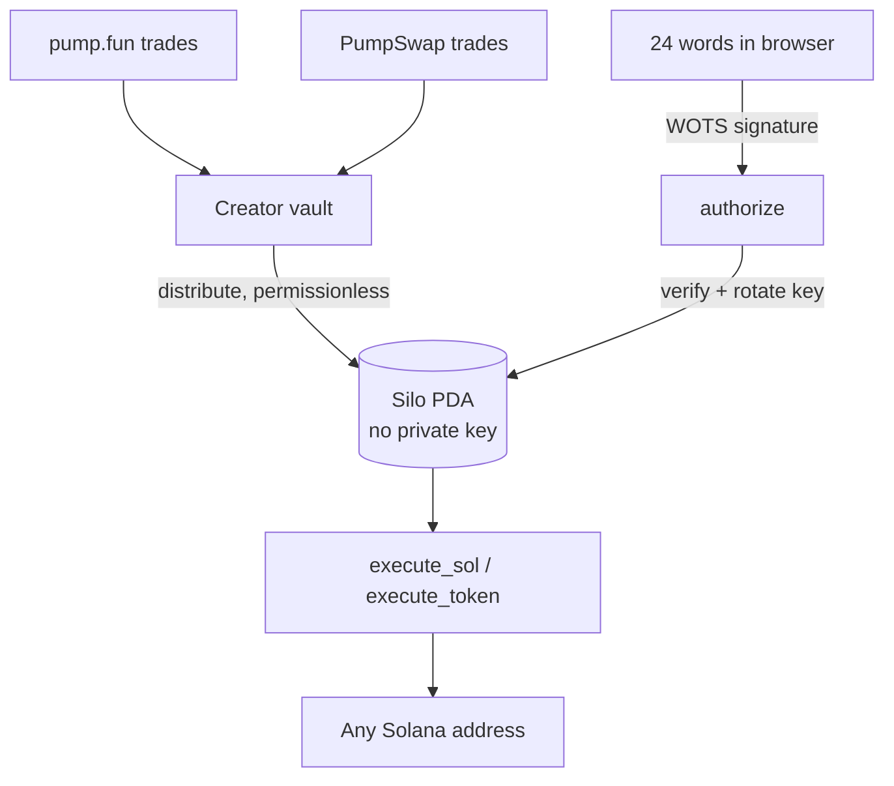
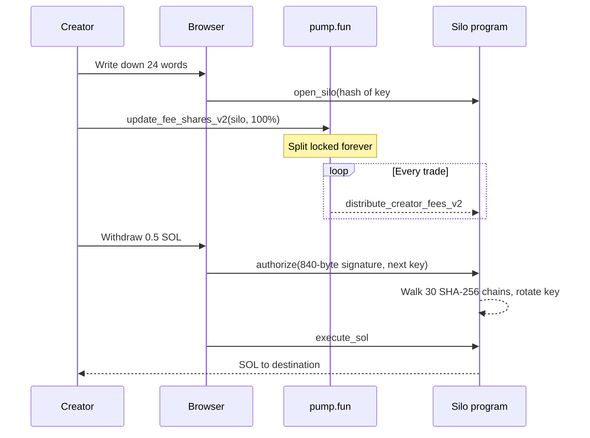

<div align="center">

<picture>
  <source media="(prefers-color-scheme: dark)" srcset="docs/assets/logo-dark.svg">
  
</picture>

# silo

**Outlive the curve.**

Post-quantum vaults for pump.fun creator fees. Set once, locked forever,<br>
opened only by a hash-based signature from your 24 words.


[](https://x.com/silodotfund)

[Website](https://silo.fund) · [X @silodotfund](https://x.com/silodotfund) · [Verify](https://silo.fund/verify) · [Docs](https://silo.fund/docs)

</div>

---

## Your address is your public key.

Bitcoin hides most public keys behind a hash until coins move. Solana can't: every address *is* an
ed25519 public key, in plain sight. If the curve ever falls, to a quantum computer or a classical
shortcut, every wallet opens at once.

Creator fees are the slowest money in crypto. They pile up for months and often sit unclaimed for
years, which makes them exactly the money a future attacker gets to. Silo moves them somewhere the
attack doesn't apply.

| Lock | Collect | Withdraw |
| :--- | :--- | :--- |
| Point a coin's creator fees at a silo through pump.fun's own fee sharing. One time, permanent. | Anyone can sweep fees in. The silo fills on its own, for years if you want. | Sign with your 24 words in the browser. The program checks a SHA-256 signature, pays, and rotates keys. |

### The difference

- **No key to steal.** A silo is a program address. No ed25519 private key exists for it, so there is nothing for Shor's algorithm to work on.
- **Locked by pump.fun, not by us.** Pump.fun's fee split can only be set once, then its admin is revoked. Nobody can redirect it later: not the creator, not silo.
- **Hash-only withdrawals.** Every withdrawal carries an 840-byte Winternitz signature verified on chain. No elliptic curve is involved at any step.
- **One-time keys.** Each signature retires its key and commits to the next one, so a signature can never be replayed.
- **Permissionless plumbing.** Anyone can sweep fees in or submit a signed withdrawal. The signature is the authority, not the fee payer.

### Why now

In October 2026 Google Quantum AI showed magic state cultivation running on real hardware for the
first time: 40× fewer errors on the Willow chip and 99.99% logical fidelity. Earlier in the year its
estimate for breaking Bitcoin's curve dropped below 500,000 physical qubits, roughly 20× fewer than
before. Nobody knows the date. Your fees don't need to.

## pump.fun integration

Silo is built on pump.fun's creator fee sharing, so it works for coins that already exist, on the
bonding curve or graduated to PumpSwap.

| Instruction | Program | What silo uses it for |
| :--- | :--- | :--- |
| `create_fee_sharing_config` | Pump Fees | Move the coin's creator vault into a sharing config |
| `update_fee_shares_v2` | Pump Fees | Set the silo as recipient. Callable once, then the admin is revoked |
| `transfer_creator_fees_to_pump_v2` | PumpSwap | Sweep fees earned after graduation back to the bonding curve vault |
| `distribute_creator_fees_v2` | Pump | Pay accrued fees into the silo. Permissionless |

Signing happens entirely in the browser with [`src/lib/wots.ts`](src/lib/wots.ts):

```ts
import { newMnemonic, seedFrom, deriveKey, encodeWithdrawal, grindSalt, sign, verify } from "./lib/wots";

const words = newMnemonic();                    // 24 words, never leave the tab
const seed = seedFrom(words);
const key = deriveKey(seed, 0);                 // one-time key #0
const next = deriveKey(seed, 1);                // the silo rotates to this after use

const base = { program, vault, keyIndex: 0, kind: "sol", mint, amount: 500_000_000n, destination, nextKeyHash: next.pkHash };
const { salt } = grindSalt(base);               // bound the on-chain verify cost
const msg = encodeWithdrawal({ ...base, salt });

const sig = sign(key, msg);                     // 840 bytes
verify(sig, msg, key.pkHash).ok;                // true, the same check the program runs
```

## Architecture



The boundary is deliberate: fees move without anyone signing, and only a hash-based signature can
move them out.

### From lock to withdrawal



## Signature scheme

| Parameter | Value |
| :--- | :--- |
| Scheme | Winternitz OTS (WOTS+-style tweaks), w = 256 |
| Hash | SHA-256, chain values truncated to 224 bits |
| Chains | 28 message digits + 2 checksum digits = 30 |
| Signature | 840 bytes, fits in one transaction |
| Verify cost | ≤ 3,600 hashes (client grinds a salt to bound it) |
| Keys | One-time. Each withdrawal commits to the next key's hash |
| Security | ~112-bit against Grover. Shor does not apply |

## Repository map

| Path | Responsibility |
| :--- | :--- |
| `programs/silo/` | Anchor program: `open_silo`, `authorize`, `execute_sol` |
| `src/lib/wots.ts` | Key derivation, signing, salt grinding, verification |
| `src/lib/chain.ts` | Addresses and transaction steps |
| `src/lib/api.ts` | API client and live updates |
| `server/` | API server: SQLite storage, signature checks, live stream |
| `src/pages/` | Coins, Lock fees, Your silo, Verify, Docs |
| `src/components/` | Nav, footer, logo |
| `docs/` | README assets |

TypeScript on the client, Rust on chain. The browser and the program share one message layout, so a
signature made in the tab verifies on chain byte for byte.

## Start here

```bash
npm install
npm run server   # API on :8787 (SQLite, seeded with demo data)
npm run dev      # site on :5173, proxies /api to :8787
```

Requires Node 22.13+ (the API uses the built-in `node:sqlite`, no other dependencies).

## Deploy

The site is hosted on **Netlify** at `silo.fund`; the API runs on **Railway** at `api.silo.fund`.

**Railway (API)**

1. Create a project from this repo. `railway.json` sets the build (`npm run build`) and start (`npm start`) commands.
2. Attach a **volume** at `/data` and set `DATABASE_PATH=/data/silo.db` so data survives redeploys.
3. Set `CORS_ORIGIN=https://silo.fund,https://www.silo.fund`.
4. Add the custom domain `api.silo.fund` and create the CNAME record Railway shows.

**Netlify (site)**

1. Import this repo. `netlify.toml` sets the build command, the `dist` folder, the SPA redirect and `VITE_API_URL=https://api.silo.fund`.
2. Keep `silo.fund` as the site's custom domain.

Optional Railway variables: `SEED_DEMO=0` to start with an empty board, `PROGRAM_ID`.

### API

| Method | Path | Description |
| :--- | :--- | :--- |
| `GET` | `/api/coins` | Every coin in a silo, newest first |
| `GET` | `/api/lookup/:mint` | Market data for any mint, and whether it is already locked |
| `POST` | `/api/locks` | Record a lock. Requires the creator wallet's signature over the lock message |
| `GET` | `/api/releases` | Latest withdrawals |
| `GET` | `/api/releases/:id` | One withdrawal, with its full 840-byte signature |
| `POST` | `/api/releases` | Submit a withdrawal. The server verifies the WOTS signature and key rotation before accepting it |
| `GET` | `/api/stream` | Server-sent events: `coin` and `release` |

## Verify it yourself

Don't trust us. Re-run the math. Open [silo.fund/verify](https://silo.fund/verify), pick any
withdrawal, and your browser re-walks all 30 hash chains from the raw signature bytes. Tick
**forge it** to add a single lamport to the signed amount and watch the check fail.

## Security by boundary

- **Your words never leave the tab.** Only hashes of public keys go on chain.
- **Lost words means a sealed silo.** There is no recovery path, by design.
- **Silo protects fees from a broken signing curve.** It cannot protect against Solana itself failing. Validators still sign blocks with ed25519.
- **Routed fees only.** Any share you don't route to the silo keeps flowing to your normal wallet.
- **Leaving is the weak point.** A withdrawal to a normal wallet is only as safe as that wallet.

Nothing here is financial advice.

## License

[MIT](LICENSE)

<div align="center">
<br>
<a href="https://silo.fund">silo.fund</a> · <a href="https://x.com/silodotfund">@silodotfund</a>
</div>
